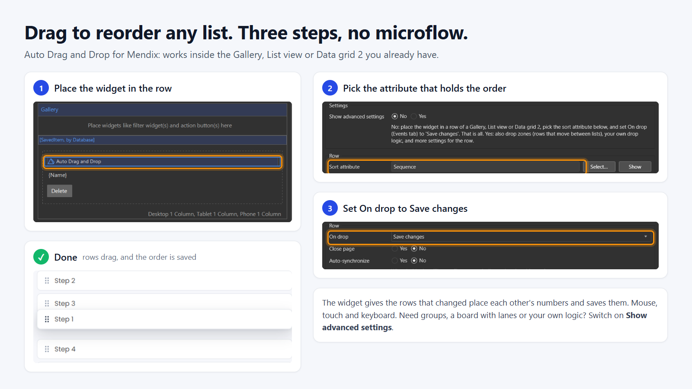

# Auto Drag and Drop

A Mendix pluggable widget (`homezero.dragdrop.DragDrop`, shown in Studio Pro as "Auto Drag and Drop") that makes the
rows of a list you already have draggable. You place it in a row; it draws a six-dot grip there and makes that row
draggable among the rows of its list. The list itself (a Gallery, a Data grid 2, a List view) keeps loading and
showing its own data, so it looks exactly as before.

It works with mouse, touch and keyboard, in vertical lists, horizontal lists, wrapping grids, grouped lists and
boards with lanes. It has no dependencies besides Mendix itself.

- Live demo: https://autodraganddrop-sandbox.mxapps.io/ (no login needed; a free app, so the first visit can take a
  while to wake it up).
- Mendix Studio Pro 11.12 or later, web (React client).
- Licence: Apache 2.0.
- Questions and bugs: [GitHub issues](https://github.com/HomeZeroTech/mendix-autodragdrop-widget/issues). Support is
  best effort.



## Three steps

Your rows have a number that says in which order they go (an Integer, Long or Decimal attribute, say `Sequence`),
and the list is sorted by it.

1. Put the widget in the row: in the template of a Gallery or List view, or in a custom-content column of a
   Data grid 2.
2. **Sort attribute**: pick that attribute.
3. **On drop** (Events tab): choose **Save changes**, with Close page set to No.

That is all: no microflow. When a row is dropped, the widget gives the rows between the old and the new place each
other's numbers, and On drop saves every row it changed. Drag the last of twenty rows to the top and twenty rows get
a new number; swap two neighbours and two do. Rows outside that range are not touched, so it also works in a list
with pages or with numbers that do not start at 1.

Good to know:

- **Write access.** The widget changes the sort attribute as the user, so the user's role needs write access to it.
  For a user without it the rows cannot be dragged: the dots are greyed out, with a tooltip that says why. If your
  users may not write the attribute but may reorder, use manual sequencing with a microflow (below).
- **Rows with the same number, or none.** New rows often all start at 0. The first time such a list is reordered,
  the rows that are shown are numbered 1, 2, 3 and so on. With pages, that is the rows of the page you are on.
- **List view.** Mendix gives a widget in a List view a read-only attribute unless the List view's own
  **Editable** setting is Yes. Set that, or the dots stay greyed out. A Gallery and a Data grid 2 need nothing.
- **On drop is what saves.** Without it nothing is stored: the row slides back, and the browser's console says so.
  Instead of Save changes you can pick a microflow or nanoflow that commits the row, for example to do something
  more after each change.

## Advanced settings

Set **Show advanced settings** to Yes for everything below.

### Your own drop logic (manual sequencing)

Set **Sequencing** to Manual. The widget then changes nothing. On drop runs once, for the dragged row, with that
row's object as context and these variables:

| Variable | Meaning |
|---|---|
| `newSortValue` | A value between the new neighbours: the average of both, the row below − 1, the row above + 1, or 0 in an empty list |
| `newIndex` | 0-based position among the rows shown, without the dragged row |
| `afterKey`, `beforeKey` | Item keys of the new neighbours (empty at the start or end) |
| `toZoneKey`, `fromZoneKey` | Zone keys, when drop zones are used |

In the flow: set the sort attribute to `newSortValue`, retrieve the siblings in order, renumber them 1..n in a loop,
commit, and refresh one object so the list reloads. A microflow that does not apply entity access can do this for
users who may not write the attribute themselves.

The widget shows the row at its new place at once and keeps that preview until the list reloads. When the list does
not change (the flow refused the move), the row slides back.

### Rows that move between lists (drop zones)

Add a second widget with **Role** = Drop zone to each lane or group, give it a **Zone key**, and give the rows an
**Item key**. Rows and zones only meet when their **Group** is the same. A move to another list is always yours to
store (the widget cannot know what makes a row belong to a lane), so the rows use manual sequencing. Either side can
handle the drop: the row's On drop gets `toZoneKey`; the zone's On drop in zone gets `draggedKey`.

A drop zone is one of two things (**Drop zone is**):

- **An element around this widget** (default): place the widget anywhere inside the lane or group and name that
  element with a CSS selector, e.g. `.board-lane`. The widget itself shows nothing. It must sit *inside* the element;
  next to it does not count.
- **The content of this widget**: place the list inside the widget. The widget draws a box around it and that box is
  the drop zone.

An empty list needs a drop zone around it. If the zone holds more than one list, give the target list the class
`dragdrop-list`.

## Settings

| Tab | Setting | Purpose |
|---|---|---|
| General | Show advanced settings | No (default): the General tab shows only the settings marked "basic" below |
| General | Sort attribute (basic) | The Integer, Long or Decimal attribute that holds the order |
| General | Drag by (basic) | Whole row (default) or six dots only |
| General | Show six dots (basic) | Draw the grip where the widget sits (default on) |
| General | Role | Handle (default) or Drop zone |
| General | Group | With drop zones: rows only drop in zones of the same group |
| General | Disabled | An expression: the row cannot be dragged / the zone accepts no drops. A disabled row still makes room for others |
| General | Sequencing | Automatic (default) or Manual, see above |
| General | Item key | The row's name in the drop actions |
| General | Row (CSS selector) | The element that moves, when it is not the list item the widget sits in |
| General | Handle label | Screen reader text and tooltip; empty = a built-in Dutch, German or English text |
| General | Zone key, Drop zone is, Element (CSS selector), Content | For the Drop zone role, see above |
| Events | On drop | Automatic: Save changes. Manual: your flow |
| Events | On drop in zone | Drop zone: action with the zone as context |
| Animation | Animate list changes | Animate the list whenever it changes, not only after a drag (default on) |
| Animation | Duration | How long a row takes to move to another place, in milliseconds (default 200; 0 = no animation) |
| Animation | Animation flow | Ease in-out, Ease in, Ease out (default) or Linear |

Switching Show advanced settings back to No: first set the advanced settings back to what they were (Role to Handle,
Sequencing to Automatic, Group to `default`, the others empty). Studio Pro reports a widget that holds a value in a
setting it no longer shows.

Behaviour worth knowing:

- **Whole row**: buttons, links and inputs in the row keep working, and a drag does not click the row. On touch a
  press on the dots picks the row up at once; elsewhere it needs a short hold, so a swipe still scrolls.
- **Keyboard**: focus the dots, Space or Enter picks up, the arrow keys move, Space or Enter drops, Escape cancels.
  The arrows follow the list: Up and Down in a list that runs down, Left and Right in one that runs sideways, all
  four in a wrapping grid (Up and Down by a whole line). While a row is picked up, the list around it does not
  get those keys, so a Gallery or Data grid 2 does not move the focus away.
- **Escape** during a mouse or touch drag puts the row back.
- **Duration and Animation flow** also set the speed of the drag itself, so they stay in use when Animate list
  changes is off. The pair applies to everything that moves in the list: rows making room during a drag, the dropped
  row landing (a little quicker), rows sliding after a list change, a new row coming in (a little longer, after a
  short pause) and a deleted row fading away.
- **Moves in quick succession** do not wait for the server. A row picked up while an earlier move in the list is
  still being saved is dragged on top of what the list shows. The drops are then stored one at a time, each after
  the one before it. If one is refused, it and the moves made on top of it slide back. Only after a move to another
  list does the next drag wait until that move is confirmed.
- **Animate list changes** does what an auto-animate wrapper around the list would do; do not use both, they would
  each move the rows. A row that is added fades in, a row that is deleted fades away where it was, and the rows in
  between slide to their new place. A list that is loaded anew (no row stayed: another page, another filter) just
  appears, as does the first row of an empty list. A deleted Data grid 2 row disappears at once while the others
  slide. Users who ask their system for reduced motion get none of this.

## Styling

The widget's CSS is structural. Colours come from custom properties your theme can set:
`--dragdrop-handle-color`, `--dragdrop-handle-hover-color`, `--dragdrop-handle-hover-background`,
`--dragdrop-focus-color`, `--dragdrop-lift-shadow`, `--dragdrop-zone-over-outline`.

Hooks for app styles: `.dragdrop-handle`, `.dragdrop-handle--locked` (the user may not reorder), `.dragdrop-ghost`
(the copy that follows the pointer), `.dragdrop-leaving` (the copy of a deleted row while it fades away),
`[data-dragdrop-row]`, `[data-dragdrop-zone]`, `[data-dragdrop-over]` (the zone under the pointer) and
`html.dragdrop-active` (while dragging).

## Limits

- **Accessibility.** There is keyboard support, but this widget alone does not make a list meet WCAG:
  the keyboard moves a row within its own list only (not to another lane or group), a screen reader hears the handle
  label but no position while the row moves, and there is no click-only alternative to dragging (WCAG 2.5.7). Keep
  or add move buttons where you need that. Planned for a later version.
- A row needs the six dots to be reachable by keyboard.
- Automatic sequencing works within a list. Rows that move between drop zones need your own drop logic.
- Automatic sequencing saves each changed row with its own request. That is fine for the lists people reorder by
  hand; for moves across hundreds of rows, use manual sequencing with one microflow.
- Rows without the widget in a list with the widget are not shifted during a drag.
- Not built: dragging several rows at once, trees (dropping onto a row), dragging from a palette, and "nothing may be
  dropped above this row" (let the drop action refuse instead).
- In a wrapping grid the gap animation assumes cells of equal size.
- After a move to another list the next drag waits until that move is confirmed. Moves within a list do not wait.
- With manual sequencing, moves in a queue rely on the list reloading after each drop action. A flow that changes
  the order without refreshing anything leaves the queue waiting until the move counts as refused (about 1.5 s
  after the action).

## How it works

- `src/engine` has no Mendix or React dependency. It is given DOM elements (rows, grips, zones) and callbacks. It
  uses pointer events, no drag library and not the browser's built-in drag-and-drop (which has no touch).
- Rows are rendered by Mendix, so the engine never moves them in the DOM and never touches their class names. During
  a drag it hides the real row in place, moves a copy with the pointer and shifts the other rows with inline
  transforms. A see-through row gets a solid copy (the first background behind it), unless the row is only a
  holder for one painted element that fills it (a gallery item around a pill or a card): then the copy takes that
  element's corners, so its shadow follows the pill and no box shows around it.
- Positions are read from the layout (`offsetTop`), not from `getBoundingClientRect()`, so shifts and running
  transitions do not disturb the measurements. Data grid 2 rows have no box of their own (`display: contents`); the
  engine works on their cells.
- After a drop the shifts stay as a preview. One controller per list watches for Mendix re-rendering it and then
  slides every row from where it was shown to where it really is. That one step covers a confirmed drop (nothing
  moves), a refused drop (slides back) and ordinary list changes.
- A row can be shown away from its place in the layout for two reasons that add up: a preview (a drop the server
  has not confirmed) and a shift (a drag going on). A drag measures the rows where the previews show them, so it can
  start on top of a pending drop.
- Automatic sequencing (`src/engine/sequence.ts`): the values the places of the list have now go to the rows that
  take those places. A widget cannot commit an object itself, so each row's widget sets its own attribute and runs
  its own On drop. The list reloads after every save, in an order that is only right after the last one; until then
  every row stays where it is shown.
- `src/DragDrop.editorConfig.ts` hides the settings that do not apply to the chosen level and role. A value in a
  hidden property is error CE0463 in Studio Pro, so keep those rules and the XML in step.

## Develop

```bash
npm install
npm run build      # development build with source maps -> dist/<version>/homezero.DragDrop.mpk
npm run release    # minified build, the one that is published
```

`@mendix/pluggable-widgets-tools` is pinned to 11.12.0 (Studio Pro 11.12, Node 20 or later). If the build fails
on `@napi-rs/lzma` on Windows, install its platform package by hand:
`npm install --no-save @napi-rs/lzma-win32-x64-msvc@<version of node_modules/@napi-rs/lzma>`.

To develop against a Mendix app, put the app in `tests/testProject` (ignored by git): `npm run build` and
`npm start` copy the widget into that app's `widgets` folder. Changing a property in `src/DragDrop.xml` makes every
placed widget out of date; update them in Studio Pro with "Update all widgets".

### Harness

A page with hand-made lists that mimic what Mendix renders, driven by a fake server with a delay and a "refuse"
switch. It runs the engine without Mendix.

```bash
npm run harness        # builds dev/build/engine
node dev/serve.mjs     # http://localhost:4173/dev/harness.html
```

The buttons above the status list and the data grid add and delete rows, "Load anew" replaces every row, and
"Widget renders after its row" registers each new row a moment late. List 7 uses automatic sequencing: its fake
server saves the rows one by one and reloads the list after each. `window.harness.animations()` returns what the
engine set in motion since the last call (`enter:`, `leave:`, `slide:` with the row's text), which is how the list
animations are checked without watching them. The toolbar's Duration and Animation flow apply to every list on the
page.

`npm run drive` checks the harness the way a person in a hurry would use it: a real (headless) Chrome with a real
mouse and touch screen makes chains of moves 0 to 600 ms apart against a server of 350 and 900 ms, in every kind of
list, picks the same row up again right after dropping it, and reports where a list did not end up as those moves
describe; then it goes through list changes, timing, refused moves, cancel, keyboard, clicks, moves between lists,
automatic sequencing and touch. It needs the harness server running, Chrome, and Playwright, which is not a
dependency of this project:

```bash
NODE_PATH="<a folder with playwright>/node_modules" npm run drive            # everything, about 8 minutes
NODE_PATH="<a folder with playwright>/node_modules" npm run drive -- lists   # or: chains
```

Run it on a quiet machine: the chains with 0 ms between moves are sensitive to load.

`dev/robot.js` is the same hand for a check from the page itself (`await import("./robot.js")`). A browser that is
not on screen gives a page no animation frames; open `harness.html?timers` there (the engine then runs on timers),
or better, use `npm run drive`.

### Release

Set the new version in `package.json` and `src/package.xml`, commit, and push a tag `v<version>`. The GitHub Action
in `.github/workflows/release.yml` builds the `.mpk` and attaches it to a GitHub release, which is what the Mendix
Marketplace imports.

## Licence

Copyright 2026 HomeZero B.V. Licensed under the [Apache License, Version 2.0](LICENSE.txt).
